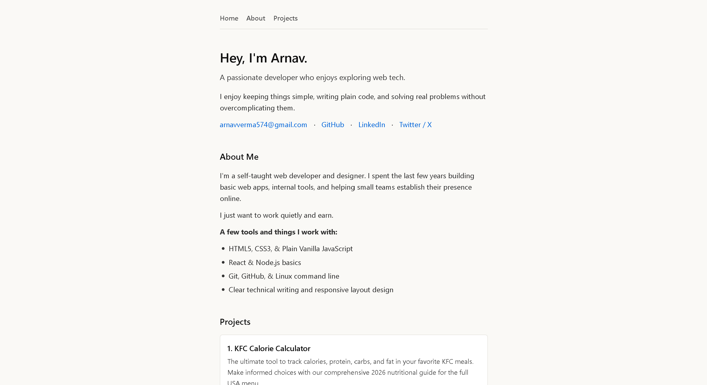

# Personal Portfolio Website

Hello Guys Welcome to my portfolio webstie. I have created this website to display the projects I have made.!!

---

## 🔗 Live Demo

You can view the website using the below link.
👉 **[Launch Live Site](https://bytecyro.github.io/Project-Portfolio/)**

---

## ⚡ Quick Start

If you want to create your own portfolio using my source code just download the files or clone it ,then change the code in index.html.

---

## ✨ Features

- **Responsive Single-Page Layout:** The website will run smoothly on all devices like smartphone,tablet,desktop.
- **Three Core Sections:** The webpage is divided in three parts-1st Part holds the navbar and my intro.
2nd Part hold the about me section which tells people about my skills and knowledge.
3rd Part contains the projects I have made so far.
- **In-Page Jump Navigation:** You can directly click of the buttons in navbar to jump directly to a section you want to go.
- **Zero-Dependency Architecture:** I have written whole code in html and css so you dont need to have any dependency installed.

---

## 🛠️ How to Run Locally

### Requirements
- Any modern web browser (Chrome, Firefox, Edge, Safari, Brave).
- Git (optional, for cloning).

### Steps
1. Clone the repository:
   Using following command
   git clone [https://github.com/ByteCyro/Project-Portfolio.git](https://github.com/ByteCyro/Project-Portfolio.git)
   cd Project-Portfolio